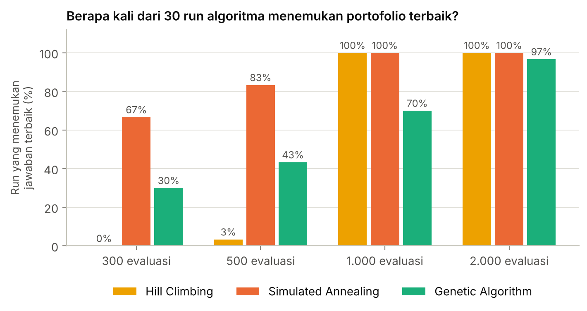

# Optimasi Portofolio Saham LQ45 dengan Local Search

ETS **Konsep Kecerdasan Artifisial**

- Hilmi Fauzi Adha Simamora - 5053251013
- Muhammad Hisyam N. - 5053251031
- Farrel Aryasatya Raharjo - 5053251036
- Dzakwan Ghonim F. M. - 5053251045
- Rilo Zidane A. T - 5053251048

**Pertanyaannya:** kalau mau membeli 5 saham dari LQ45 (masing-masing 20% modal), kombinasi
mana yang paling bagus? Ada total **850.668** kombinasi, jadi kita coba pakai algoritma *local search*
lalu membandingkannya:

| Algoritma | Cara kerja singkat |
|---|---|
| **Hill Climbing** (+ random restart) | cek semua tetangga, pindah ke yang terbaik, mulai ulang kalau mentok |
| **Simulated Annealing** | cek 1 tetangga acak, kadang menerima yang lebih buruk, suhu turun pelan-pelan |
| **Genetic Algorithm** | populasi portofolio + seleksi, crossover, mutasi |
| Brute force | hitung semua kombinasi, dipakai sebagai **kunci jawaban** |

- **State:** 5 saham · **Tetangga:** tukar 1 saham (185 tetangga) · **Fungsi objektif:** Sharpe ratio
  = (return − bunga bank) ÷ risiko

> ⚠️ Hasil proyek ini **BUKAN rekomendasi investasi**.

📓 [Notebook colab](notebook/demo.ipynb)

## Hasil

- Portofolio terbaik (brute force): **ACES, ADRO, BRIS, JPFA, MAPA**, Sharpe ratio **1,82**.
- Persentase dari 30 *run* yang menemukan portofolio terbaik:

| Jatah evaluasi | Hill Climbing | Simulated Annealing | Genetic Algorithm |
|---:|---:|---:|---:|
| 300 | 0% | 67% | 30% |
| 500 | 3% | 83% | 43% |
| 1.000 | 100% | 100% | 70% |
| 2.000 | 100% | 100% | 97% |

- **Simulated Annealing** paling efisien saat jatah sedikit. **Hill Climbing** selalu berhasil jika jatah
  cukup, karena tiap langkahnya mahal (185 evaluasi). **Genetic Algorithm** cepat di awal, tetapi sering
  meleset 1 saham.
- Cek dunia nyata (dibeli 3 Feb 2025, disimpan sampai 15 Okt 2026): portofolio terbaik **82**, indeks LQ45
  **73**, semua 42 saham bobot sama **100** (modal awal 100). Terbaik di masa lalu belum tentu terbaik di masa
  depan.



## Cara menjalankan

```bash
pip install -r requirements.txt
python -m src.eksperimen     # semua percobaan (< 1 menit)
python -m src.grafik         # semua grafik
```

Atau bisa pakai Colab Notebook tersebut.

Data harga: Yahoo Finance (sudah disesuaikan dividen & stock split). Daftar LQ45: pengumuman BEI periode
Februari–April 2025.
